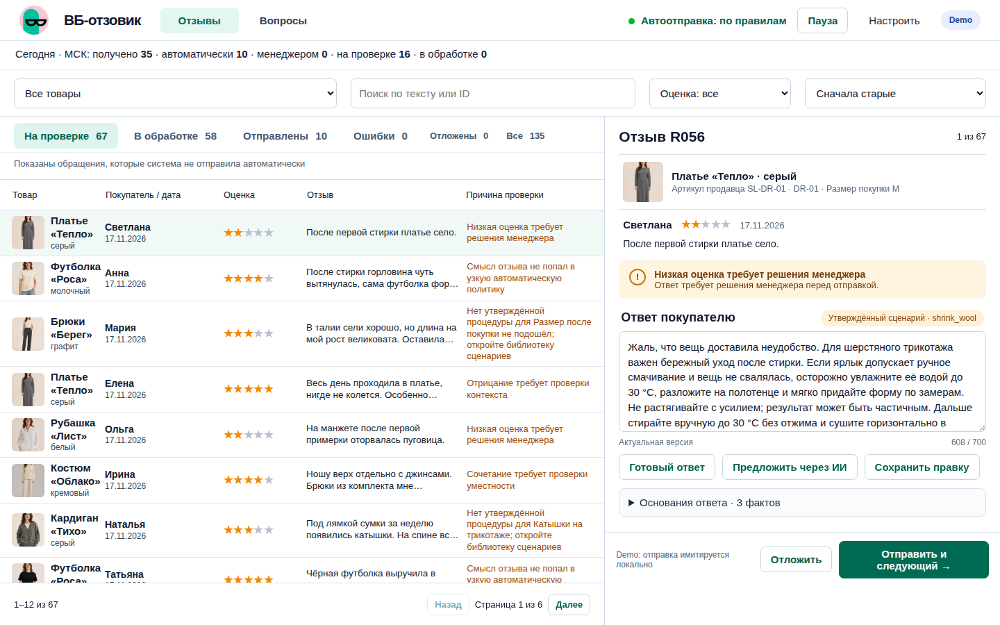

# ВБ-отзовик

Веб-помощник для продавцов одежды на Wildberries. Во время распродажи одна футболка может получить десятки похожих отзывов. Простую похвалу система обрабатывает по правилам магазина, а жалобу на усадку показывает менеджеру вместе с фото вещи, размером, готовым ответом и инструкцией именно для этой модели.

[Посмотреть очередь, ответы и кампании (короткое видео, MP4)](media/walkthrough.mp4) · [Подключить WB Sandbox](#свой-ключ-wb-sandbox)



## Почему для одежды

| Обращение | Как помогает панель |
| --- | --- |
| «После первой стирки платье село» | Менеджер видит применимую процедуру, температуру по ярлыку и ограничения. Условия ухода утверждает продавец для модели или отдельного варианта. |
| «Выбираю между M и L» | Ответ использует замеры конкретного изделия. Если известен только полуобхват груди для M, покупатель увидит этот замер и узнает, каких данных для сравнения не хватает. |
| «Футболка понравилась, хочу такую же чёрную» | Помощник ищет другой цвет той же модели. Актуальный остаток покупатель проверяет в карточке. |
| Покупатель хвалит фасон или мягкость ткани | Продавец может настроить сезонную кампанию с несколькими кандидатами. Правила учитывают связь товаров, размер, остаток и свежесть данных кампании. Жалобы требуют отдельного разбора. |

Отзывы после покупки и вопросы о выборе товара находятся в разных очередях. Правила определяют маршрут, шаблон или Hermes готовит текст, сервер повторно проверяет его перед отправкой. В редакторе видны источник черновика и основания ответа. Пример или новая версия сценария становятся рабочей инструкцией после утверждения продавцом.

## Запустить демо без ключей

Из корня скачанного репозитория выполните в Linux или macOS с Python 3.12:

```bash
python3 -m venv .venv
source .venv/bin/activate
python -m pip install -r requirements.txt
python run.py
```

Откройте [локальное демо](http://127.0.0.1:8767/). Дайте очереди несколько секунд на подготовку. В демонаборе 100 разных отзывов о девяти вариантах одежды, от похвалы фасона до претензий к швам и посадке. Найдите **R056** в «Отзывах», откройте платье «Тепло» и раскройте «Основания ответа». Нажатие «Отправить и следующий» запишет результат в локальную SQLite-базу. Демоданные синтетические.

Чтобы посмотреть, откуда берётся совет по уходу, откройте **Настроить → Знания и сценарии → Выбрать из библиотеки**. Выберите усадку шерстяной вещи и адаптируйте заготовку под ярлык модели. Для подбора комплектов и других цветов откройте **Настроить → Допродажи**. [Демонстрационный профиль товаров в Excel](data/profiles_v4.xlsx)

## Свой ключ WB Sandbox

Эта версия работает с **тестовым контуром** Wildberries. Ключ нужен только для проверки интеграции. Создайте собственный тестовый токен в кабинете WB. Для создания тестовой карточки нужен доступ к контенту, для получения тестового отзыва и ответа — к отзывам и вопросам с правом записи. [Документация WB API](https://dev.wildberries.ru/docs/openapi/api-information)

1. В корне проекта создайте приватный файл настроек:
   ```bash
   (umask 077 && cp -n .env.example .env)
   ```
2. Откройте **.env** текстовым редактором и вставьте токен после `WB_SANDBOX_TOKEN=`. Оставьте адрес песочницы из примера. Файл читает сервер. В Git попадает только пустой `.env.example`.
3. В активированном окружении один раз создайте пароль оператора, тестовую карточку и отзыв, затем локальный профиль с полученным артикулом:
   ```bash
   python scripts/init_operator.py
   python -m scripts.provision_sandbox
   python -m scripts.migrate_sandbox_profiles
   ```
   Вторая команда создаёт объекты в вашей песочнице WB. Третья сохраняет профиль в `.data/sandbox-v2/profiles.xlsx`. Если подготовка прервалась после создания карточки, перед повтором проверьте тестовый артикул `SL-TS-01-WBTEST` в песочнице.
4. Запустите `WB_MODE=sandbox python run.py` и откройте [локальную панель Sandbox](http://127.0.0.1:8768/). Логин — `operator`, пароль находится в локальном файле `.data/operator-key`. Найдите созданный тестовый отзыв и проверьте ответ вручную.

Demo имитирует отправку. Sandbox выполняет запрос к тестовому API и контрольное чтение. Реальная публикация на карточках магазина и влияние ответов на продажи лежат за пределами этой версии.

## Живая генерация

Шаблоны, каталог, правила и очередь доступны сразу. Для кнопки «Предложить через ИИ» нужен локальный Hermes с API, доступным на `127.0.0.1:8667`, и серверным ключом `HERMES_API_KEY`. Ключ передаётся процессу запуска через окружение или читается из `.data/hermes/server-key`. Это отдельный секрет от WB. В репозитории есть адаптер `app/hermes_server.py` и скрипт `scripts/setup_hermes.py` для окружения с установленным Hermes Agent и учётными данными OpenRouter. Подключение модели необязательно для знакомства с проектом.

## Проверка

```bash
python -m pip install -r requirements-dev.txt
# Один раз для тестов с авторизацией, если пароль ещё не создавался
test -f .data/operator-key || python scripts/init_operator.py
python -m pytest -q
```

Стек: FastAPI, SQLite, openpyxl, JavaScript и опциональный Hermes. Лицензия на код — [MIT](LICENSE).
